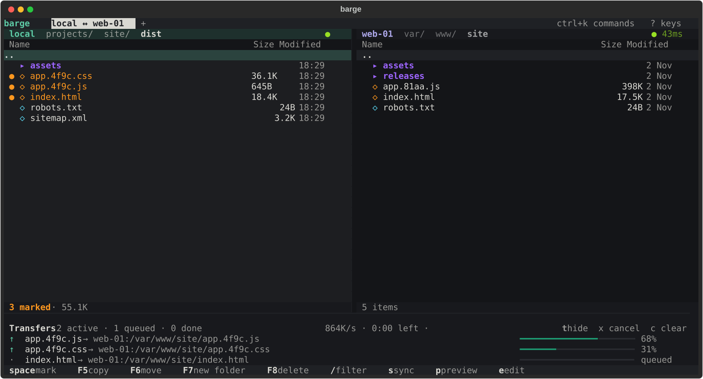

# barge

A two-pane file manager for the terminal that moves files between your disk, S3 buckets and SSH servers.



I kept bouncing between `aws s3 cp`, `scp` and Finder windows to shuffle build output and backups around, and wanted one keyboard-driven tool that treats all of them the same. barge is that tool: Midnight Commander-style panes, a transfer queue that runs in the background, and a sync preview so you can see exactly what will change before anything is touched.

## Features

- **Two panes, any mix of places.** Local, S3 (or anything S3-compatible: MinIO, R2, Wasabi) and SSH servers, side by side.
- **SSH that just works.** It reads `~/.ssh/config`, uses your keys and ssh-agent, and checks `known_hosts`. It uses SFTP, and falls back to SCP plus shell commands on servers that have the SFTP subsystem turned off.
- **Background transfers.** Parallel workers, live speed and time left, automatic retries, and cancel.
- **Sync with a preview.** See new, changed and (optionally) deleted files grouped up front, and skip individual items before running.
- **Conflict handling.** When names collide you can overwrite, skip, or keep whichever is newer, applied to the whole copy.
- **Command palette** (`ctrl+k`). Fuzzy search over saved connections, ssh hosts, recent places and commands.
- **Preview and edit.** `p` shows a file with syntax highlighting (hex for binaries). `e` opens it in `$EDITOR` and uploads it again when you save.
- **Tabs, filter, hidden files, light and dark themes.**
- **A CLI for scripts**: `barge ls`, `cp`, `mv`, `rm`, `mkdir` and `sync`, using the same backends.

## Install

Needs Python 3.11+.

```sh
uv tool install git+https://github.com/Chrisob94/barge
# or
pipx install git+https://github.com/Chrisob94/barge
```

## Usage

```sh
barge                                  # current folder on the left, home on the right
barge ./dist web-01:/var/www/site      # pick both panes
barge ~/Pictures s3://my-photos/2024
```

Locations can be:

| you type                       | means                                         |
| ------------------------------ | --------------------------------------------- |
| `~/Downloads`, `./dist`        | a local folder                                |
| `s3://bucket/some/prefix`      | an S3 bucket or prefix                        |
| `web-01:/var/www`              | a host from `~/.ssh/config`                   |
| `sftp://user@host:2222/srv`    | an SSH server (`scp://` forces SCP mode)      |
| `photos:/2024`                 | a profile from your config file (see below)   |

### Keys

| key           | does                              | key        | does                       |
| ------------- | --------------------------------- | ---------- | -------------------------- |
| `enter`       | open folder / preview file        | `F5`       | copy to the other pane     |
| `backspace`   | up a level                        | `F6`       | move to the other pane     |
| `tab`         | switch pane                       | `F7`       | new folder                 |
| `space`       | mark                              | `F8`       | delete                     |
| `ctrl+a`      | mark all                          | `F2`       | rename                     |
| `/`           | filter                            | `s`        | sync to the other pane     |
| `.`           | show hidden files                 | `p` / `e`  | preview / edit             |
| `ctrl+k`      | command palette                   | `g`        | go to a location           |
| `ctrl+t/w`    | new / close tab                   | `t`        | show or hide transfers     |
| `ctrl+r`      | refresh                           | `?`        | all keys                   |

### Command line

```sh
barge ls -l s3://my-photos/2024
barge cp -j 8 ./dist web-01:/var/www/site
barge sync --delete --dry-run ./dist s3://acme-web/static
barge rm -r web-01:/tmp/old-release
barge hosts                            # profiles plus everything in ~/.ssh/config
```

## Config

Optional. barge works off `~/.ssh/config` and your normal AWS credentials without one, but profiles give things short names. Put them in `~/.config/barge/config.toml` (or set `BARGE_CONFIG`):

```toml
[profiles.photos]
type = "s3"
bucket = "my-photos"
prefix = "originals"
region = "eu-west-1"

[profiles.minio]
type = "s3"
bucket = "backups"
endpoint_url = "http://nas.local:9000"
aws_profile = "minio"

[profiles.web-01]
type = "ssh"
host = "web-01"            # anything ~/.ssh/config knows about
root = "/var/www"
# mode = "scp"             # for servers without SFTP
# password_env = "WEB01_PASSWORD"   # if you can't use keys

[profiles.scratch]
type = "local"
root = "/Volumes/Scratch"
```

Passwords never go in the file, only the name of an environment variable to read them from.

## How it fits together

```
src/barge/
  backends/      one class per storage type, all with the same interface (base.py)
    local.py     plain filesystem, atomic writes via temp file + rename
    s3.py        boto3, paginated listings, batched deletes, multipart uploads
    ssh.py       paramiko SFTP, with an SCP + `ls` fallback (lsparse.py)
  transfer.py    the job queue: thread pool, per-thread backend clones, retries, cancel
  sync.py        diffing two trees and turning the diff into jobs
  config.py      profiles from config.toml
  location.py    "web-01:/var/www" -> (backend, path)
  cli.py         the non-interactive commands
  ui/            the Textual app: panes, palette, dock, dialogs, sync preview
```

The UI never talks to a server on the main thread. Listings run in Textual workers, transfers in the queue's thread pool, and anything holding a single connection (SSH) gets cloned per worker thread.

## Development

```sh
uv sync
uv run pytest          # spins up moto for S3 and an in-process SFTP server, no network needed
uv run ruff check .
uv run barge
```

## Not supported (yet)

- FTP / FTPS
- Resuming a half-finished transfer
- Windows (it probably mostly works, but I don't test it)

## License

MIT
